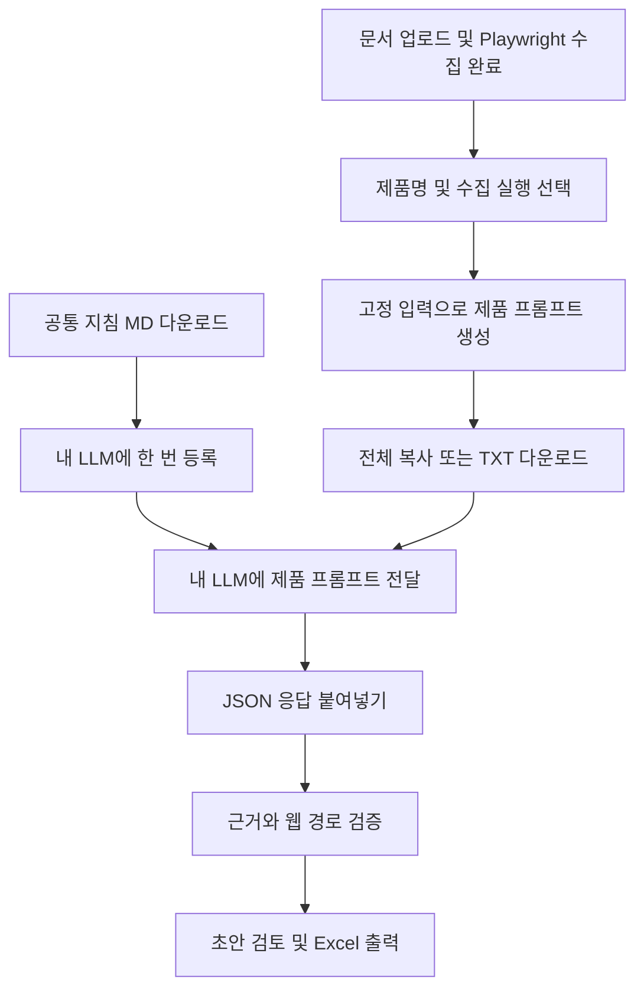

# 사용자 소유 LLM으로 메뉴트리 작성

브랜치: `dev-self-llm`. 공통 지침 계약: `self-llm-v2`.

1. 통합 메뉴트리 영역에서 **공통 작성 규칙.md 다운로드**. 지침 또는 지식 파일로 사용자 지정 LLM에 등록한다. 이 파일에는 제품별 자료가 없다.
2. 기능리스트·매뉴얼을 업로드하고 Playwright 화면 수집을 완료한다.
3. 수집 결과·작업 새로고침 후 제품명(1depth)과 수집 실행을 선택한다.
4. **내 LLM용 제품 프롬프트 만들기**. 기존 EXTERNAL 작업에 문서·수집 근거를 고정한 뒤 자동으로 제품별 프롬프트를 준비한다. 로컬 모델 추론이나 외부 API 호출은 하지 않는다.
5. **제품 프롬프트 전체 복사** 후 지침을 등록한 LLM에 붙여넣는다. 자동 복사가 차단되면 선택된 내용을 Ctrl+C로 복사한다. 동일 내용 TXT 다운로드도 제공한다.
6. 반환된 `{"rows":[...]}`를 붙여넣고 **근거 검증 후 가져오기**. JSON 코드 블록도 허용한다. 인용 불일치·없는 근거 ID는 전체를 거부하지 않고 해당 행을 `UNVERIFIED`로 저장한다. 화면에 기능명·근거 ID·원본 인용·사유를 표시한다. 정상 행은 `VALID`로 유지한다. JSON 형식·depth·길이 제한은 계속 검사한다.
7. 배치 미확인 항목·의미적 연결·누락을 검토하고 초안 Excel 또는 승인 Excel을 출력한다. 가져오기 성공은 기능 수행 성공이나 전체 누락 없음의 증명이 아니다.

제품 요청은 전체 원문 구간을 짧은 refId로 표현한 evidenceCatalog와 webStructure를 포함한다. 원본 PDF·Excel 바이너리, 화면 이미지, 로그인 설정을 별도 첨부하지 않는다. 수집·문서 텍스트에 포함된 내용은 복사되므로 전달 전 확인한다. 입력 길이(문자 수)를 표시하며 토큰 수로 오인하지 않는다. LLM 입력·출력 한도를 넘으면 전체를 처리했다고 주장하지 않도록 공통 지침에 명시한다. 요청 자료를 조용히 잘라내지 않는다.

이전 실행의 프롬프트 재생성은 해당 실행의 고정 입력을 유지한다. 공통 지침을 바꿀 때는 계약 버전을 갱신하고 `ai-service/export_self_llm_rules.py`로 다운로드 MD를 다시 생성한다. 다운로드 파일과 계약의 동기화는 `test_self_llm_prompt`로 검사한다. 제품 요청 API의 `instructionVersion`과 화면 버전이 다르면 복사를 준비하지 않는다.

기존 로컬 자동 생성은 보조 선택으로 유지한다. DB 마이그레이션은 없다.

근거 경고가 있는 기능도 실제 관찰 경로에 배치되면 초안에 포함하고 사용자가 제외하거나 승인할 수 있다. 웹 경로를 확인하지 못하면 기존처럼 배치 검토 대상으로 남긴다. 수정·분리·승인으로 근거 경고를 자동 해제하지 않는다. Excel 본문은 미확인 근거 행을 노란색으로 표시하고, 포함 여부와 무관하게 `근거 검증 경고` 시트에 원본 인용과 사유를 남긴다. 승인본에서도 경고는 유지된다. 로컬 자동 생성의 엄격한 검증 정책은 바꾸지 않는다.

## v2 근거 선택

공통 지침 MD를 v2로 교체하고 제품 프롬프트를 다시 만든다. LLM은 evidenceRefIds에 E0001 같은 번호만 선택한다. 서버는 고정 입력에서 번호별 정확한 원문과 실제 sourceId를 복원한다. 선택한 메뉴·버튼의 메뉴 키도 서버가 복원한다. 응답 최상위 requestId가 현재 작업 UUID와 다르거나 없으면 새 번호 방식 가져오기를 차단하여 다른 실행의 번호가 연결되지 않게 한다. 알 수 없는 번호는 근거 미확인 경고로 보존한다. 기존 evidence/sourceId/quote JSON도 계속 지원한다. 번호 선택이 의미적으로 옳은지는 사용자 검토 대상이며 형식 검증만으로 의미적 일치를 확정하지 않는다.
